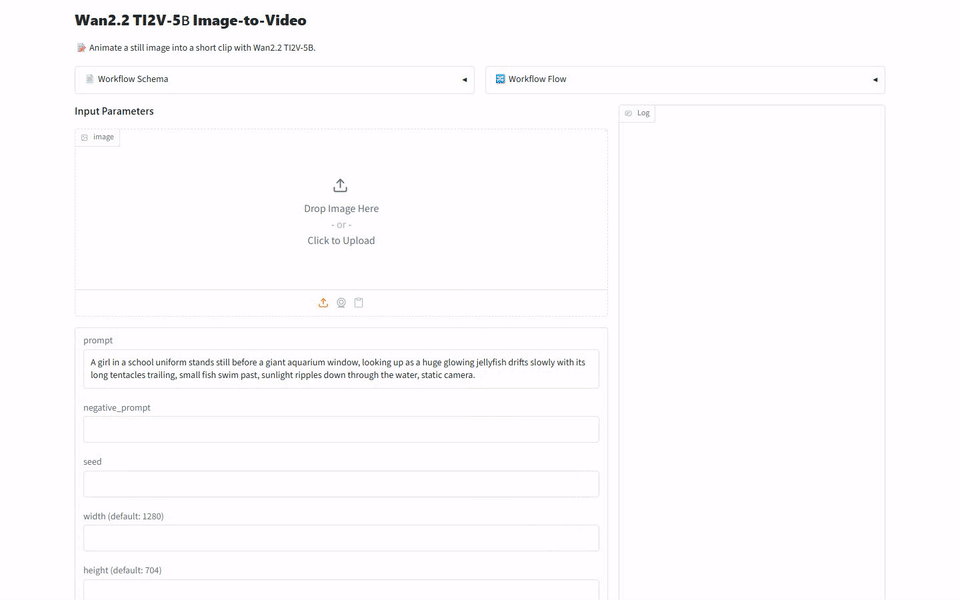
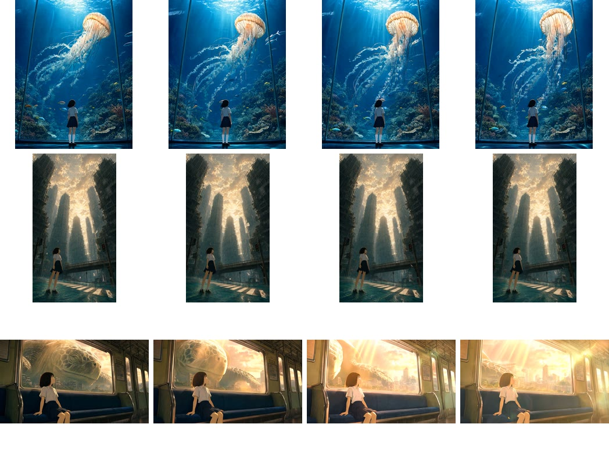

[English](README.md) · [한국어](README.ko.md) · [中文](README.zh.md)

# image-to-video-wan

이 서비스는 그림 한 장과 움직임을 적은 프롬프트를 받아, 그 그림에서 시작하는 짧은 영상을 Wan-AI/Wan2.2-TI2V-5B로 만들어 돌려줍니다.

측정한 기기: DGX Spark, RTX 4090. 다른 모델과는 비교하지 않았습니다.
“사람 판정”으로 표시한 결과는 사람이 에이전트의 제안을 보기 전에 내린 판정입니다.
기능 관찰은 모두 사람이 출력을 직접 보거나 듣고 썼고, 에이전트 초안은 그 뒤에야 보였습니다.



## 모델

Wan2.2 모델 카드는 TI2V-5B가 텍스트와 이미지에서 720P, 24fps 영상을 만들고 RTX 4090 같은 소비자용 GPU 한 장에서 돈다고 말합니다.
카드는 출력 비율이 입력 그림을 따르고, 소비자용 GPU 한 장에서 짧은 720P 영상을 만드는 데 걸리는 시간 한도도 적어 둡니다.

가중치: [Wan-AI/Wan2.2-TI2V-5B](https://huggingface.co/Wan-AI/Wan2.2-TI2V-5B/tree/921dbaf3f1674a56f47e83fb80a34bac8a8f203e)

## 빠른 시작

[model-compose](https://github.com/hanyeol/model-compose) 0.4.120 이상이 필요합니다.

[uv](https://docs.astral.sh/uv/)로 설치:

```bash
uv pip install model-compose
```

또는 pip로 설치:

```bash
pip install model-compose
```

이 저장소 클론:

```bash
git clone https://github.com/MindrLabs/image-to-video-wan
cd image-to-video-wan
```

실행:

```bash
model-compose up
```

API 주소는 http://localhost:8080/api 입니다.

Gradio UI 주소는 http://localhost:8081 입니다.

## 요약

1. RTX 4090과 DGX Spark에서 쟀고, 두 기기 모두 영상 6개를 실패 없이 만들었습니다.
2. 두 기기 모두 출력이 720P 면적, 24fps, 입력 그림 비율 규칙을 통과했고, 사람이 RTX 4090의 속도 주장과 그림을 따라가는 영상이라는 주장을 통과로 판정했습니다.
3. 그림 세 장 모두 고정된 카메라 앞에서 해파리, 물결, 창밖 풍경처럼 프롬프트가 말한 움직임이 나왔지만, 두 영상에서 인물 얼굴이 일그러졌습니다.
4. 그림이 3장뿐이라 RTX 4090과 DGX Spark의 속도 차이는 통계로 확인하지 못했습니다.

| 기기 | 상태 | RTF | 최대 메모리 (MiB) |
| :---: | --- | --- | --- |
| DGX Spark | 측정 | 276 | 30135 (VRAM) |
| RTX 4090 | 측정 | 102 | 24050 (VRAM) |

## 측정 환경

기능 출력은 같은 측정 경로로 입력과 설정마다 한 번씩 만들었고, 출력마다 사람이 관찰을 확정했습니다.

| 항목 | 값 |
| :---: | --- |
| 입력 | 입력 3개 × 반복 2회 |
| 체크포인트 | [Wan-AI/Wan2.2-TI2V-5B](https://huggingface.co/Wan-AI/Wan2.2-TI2V-5B/tree/921dbaf3f1674a56f47e83fb80a34bac8a8f203e) |
| model-compose | 0.4.118 |
| 주장 판정 규칙 | fps = 24; pixels = 720p; aspect_ratio_error ≤ 0.05 |
| 통계 | 95% 구간, 1.05배 미만 속도 차이는 판정 제외 |

## 내 기기에서 돌아가나요?

- 속도는 RTF로 적었고, 생성에 걸린 시간을 출력 영상 길이로 나눈 값이라 낮을수록 빠릅니다.
- RTF 중앙값은 RTX 4090에서 102, DGX Spark에서 276 값이었습니다.
- 5.04초 영상 하나에 RTX 4090은 514초에서 518초, DGX Spark는 1338초에서 1420초 걸렸습니다.
- GPU 메모리는 RTX 4090에서 최대 24050 MiB, DGX Spark에서 최대 30135 MiB 썼습니다.

### 기기 비교

| 기기 | 지표 | 입력 | 추정 | 구간 | 결과 |
| :---: | --- | --- | --- | --- | --- |
| DGX Spark vs RTX 4090 | RTF | 3 | — | — | 판단 불가 |
| DGX Spark vs RTX 4090 | aspect_ratio_error | 3 | — | — | 판단 불가 |

## 기능별 결과

| 질문 | 결과 |
| :---: | --- |
| 그림 한 장과 짧은 프롬프트로 그 장면이 움직이는 영상을 만들 수 있나요? | 네, 세 그림 모두 그림에서 시작해 프롬프트가 말한 움직임이 나왔지만 두 영상에서 인물 얼굴이 일그러졌습니다. |

### 그림 한 장을 영상으로 (5B)

그림 세 장에 장면의 움직임과 고정된 카메라를 적은 영어 프롬프트를 함께 넣었습니다.

| 주장 | 확인 방법 | 기기 | 결과 |
| :---: | --- | --- | --- |
| TI2V-5B는 24fps 영상을 만듭니다. | 규칙 판정 | DGX Spark | 통과 |
| TI2V-5B는 24fps 영상을 만듭니다. | 규칙 판정 | RTX 4090 | 통과 |
| TI2V-5B는 720P 영상을 만듭니다. | 규칙 판정 | DGX Spark | 통과 |
| TI2V-5B는 720P 영상을 만듭니다. | 규칙 판정 | RTX 4090 | 통과 |
| TI2V-5B 영상은 입력 그림의 비율을 따릅니다. | 규칙 판정 | DGX Spark | 통과 |
| TI2V-5B 영상은 입력 그림의 비율을 따릅니다. | 규칙 판정 | RTX 4090 | 통과 |
| TI2V-5B는 그림을 따라가는 영상을 만듭니다. | 사람 판정 | — | 통과 |
| TI2V-5B는 소비자용 GPU 한 장에서 5초 720P 영상을 9분 안에 만듭니다. | 사람 판정 | — | 통과 |

| 기기 | RTF | 최대 메모리 (MiB) | aspect_ratio_error | duration_sec | fps | height | pixels | width | 주장 |
| :---: | --- | --- | --- | --- | --- | --- | --- | --- | --- |
| DGX Spark | 276 | 30135 (VRAM) | 0.0177 | 5.04 | 24 | 1003 | 878592 | 928 | 통과 |
| RTX 4090 | 102 | 24050 (VRAM) | 0.0177 | 5.04 | 24 | 1003 | 878592 | 928 | 통과 |

각 칸은 측정한 호출의 중앙값이며 다른 GPU 작업 중에 한 호출은 빼고 계산합니다.

| 기기 | 입력 | 초 | RTF | 최대 메모리 (MiB) |
| :---: | --- | --- | --- | --- |
| RTX 4090 | aquarium-jellyfish | 518 | 103 | 24008 (VRAM) |
| RTX 4090 | flooded-city | 514 | 102 | 24050 (VRAM) |
| RTX 4090 | train-turtle | 518 | 103 | 23928 (VRAM) |



RTX 4090: 수족관, 침수된 도시, 기차와 거북 영상에서 고른 프레임입니다.

행(위에서 아래로):

- aquarium-jellyfish: prompt=A girl in a school uniform stands still before a giant aquarium window, looking up as a huge glowing jellyfish drifts slowly with its long tentacles trailing, small fish swim past, sunlight ripples down through the water, static camera.; image
- flooded-city: prompt=A girl stands in shallow clear water on a flooded crosswalk between towering scaffolded buildings, looking up at a golden sky, clouds drift slowly, sheets of paper flutter in the wind, gentle ripples spread across the water, static camera.; image
- train-turtle: prompt=A girl sits on a train bench gazing out the window as a giant turtle glides past over a ruined, overgrown city, its eye blinking slowly, warm sunbeams shift across the carriage as the train sways gently, static camera.; image

- 수족관 영상에서는 해파리가 움직이고 물고기가 헤엄치며 카메라는 고정돼 있었습니다.
- 침수된 도시 영상에서는 수면이 물결치고 깃발이 휘날리며 카메라는 고정돼 있었습니다.
- 기차와 거북 영상에서는 거북이 눈을 깜빡이고 창밖 풍경이 지나가며 빛이 산란했고, 카메라는 고정돼 있었습니다.

## 추천

- RTX 4090에서는 GPU 메모리를 거의 다 쓰니, 같은 GPU에서 다른 작업을 함께 돌리지 않기를 권합니다.
- 인물 얼굴이 일그러질 수 있으니 결과 영상을 끝까지 보고 쓰기를 권합니다.

## 한계와 측정하지 않은 것

### 결함

- 침수된 도시 영상에서 인물 얼굴이 일그러졌습니다.
- 기차와 거북 영상에서 빛이 지나치게 강해지고 인물 얼굴이 일그러졌습니다.

### 그 밖의 한계

- DGX Spark / RTX 4090 기기 간 RTF 비교는 하지 못했습니다: 두 기기에서 다른 GPU 작업 없이 잰 입력이 3개뿐이고, 20개 이상이 필요합니다.
- DGX Spark / RTX 4090 기기 간 aspect_ratio_error 비교는 하지 못했습니다: 두 기기에서 채점한 입력이 3개뿐이고, 20개 이상이 필요합니다.
- 여기서 시험하지 않은 주장입니다: TI2V-5B 단일 GPU 명령은 RTX 4090 같은 24GB GPU에서 돕니다.
- 서버는 PYTORCH_CUDA_ALLOC_CONF=expandable_segments:True를 설정합니다, 이 설정이 없으면 RTX 4090에서 VAE 디코딩 중 메모리가 모자랐기 때문입니다.
- 속도와 사람 판정은 그림 3장으로만 쟀습니다.
- 카드가 적은 단일 GPU 메모리 요구는 RTX 4090 한 대로만 봤고, 그 주장 자체는 따로 시험하지 않았습니다.
- 규칙이 있는 주장은 기기마다 출처가 밝힌 숫자와 대조해 판정했습니다.

## 라이선스

| 대상 | 라이선스 | 상업적 이용 |
| :---: | --- | --- |
| 이 서비스 | [`LICENSE`](LICENSE) | ✓ |
| Wan2.2-TI2V-5B 가중치 | [`MODEL_LICENSE`](https://huggingface.co/Wan-AI/Wan2.2-TI2V-5B/blob/main/README.md#license-agreement) | ✓ |
