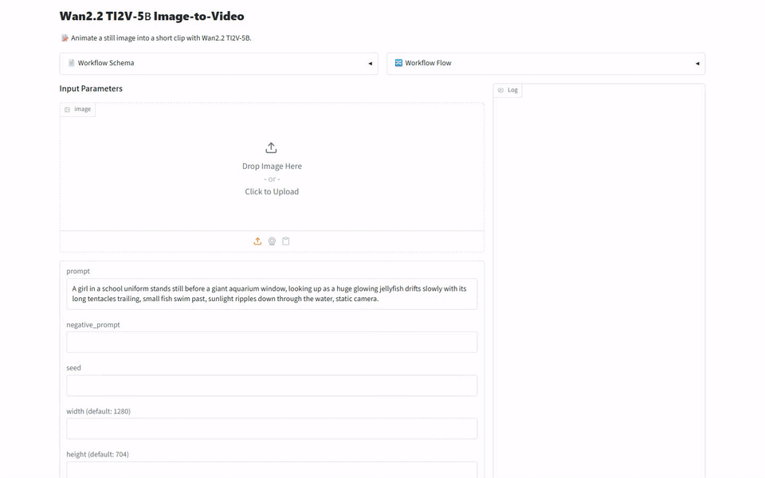
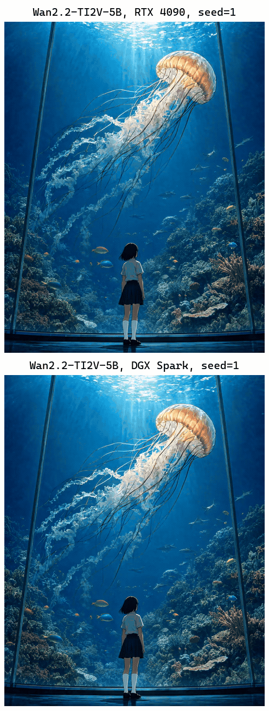
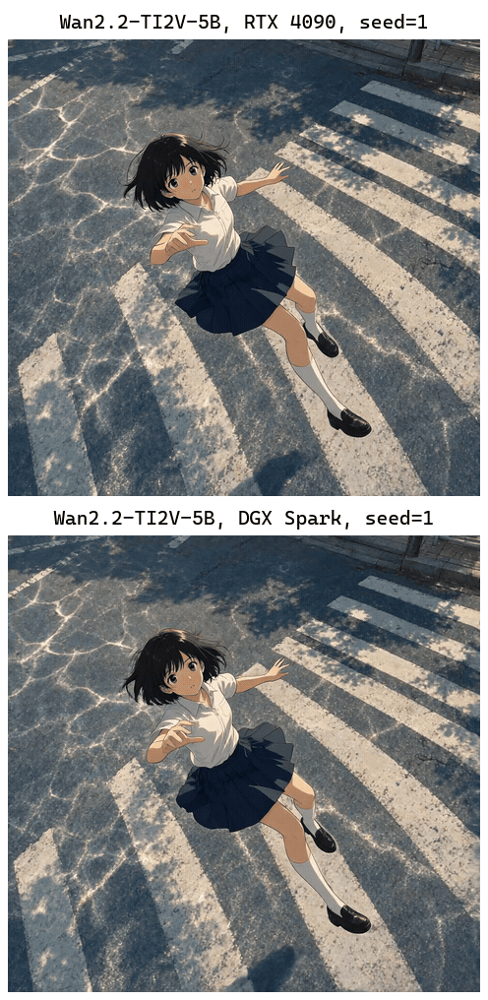
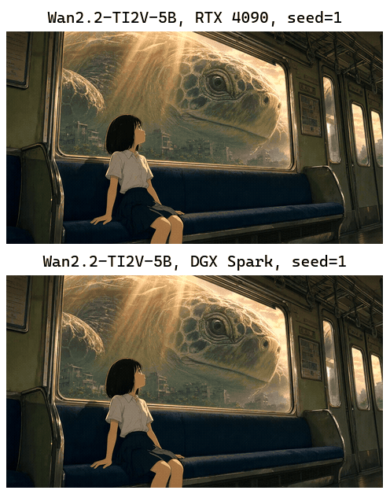

[English](README.md) · [한국어](README.ko.md) · [中文](README.zh.md)

# image-to-video-wan

This service takes an image and a text description and returns a short video made with Wan-AI/Wan2.2-TI2V-5B.



## Quick Start

It needs [model-compose](https://github.com/hanyeol/model-compose) 0.4.120 or later.

Install with [uv](https://docs.astral.sh/uv/):

```bash
uv pip install model-compose
```

Or with pip:

```bash
pip install model-compose
```

Clone this repository:

```bash
git clone https://github.com/MindrLabs/image-to-video-wan
cd image-to-video-wan
```

Run it:

```bash
model-compose up
```

The API listens on http://localhost:8080/api and the Gradio UI opens at http://localhost:8081.

## Summary

The RTX 4090 made each 5.04-second video in a median of 526 seconds, meeting the model card's speed claim for a single consumer GPU.

| Machine | Status | RTF | Peak memory (MiB) |
| :---: | --- | --- | --- |
| DGX Spark | Measured | 281 | 30013 (VRAM) |
| RTX 4090 | Measured | 104 | 23942 (VRAM) |
| MacBook M1 16GB | Not measured | — | — |

## Setup

Measured with model-compose 0.4.120. Statistics use 95% intervals, and speed differences under 1.05× are not called.

| Inputs | Weights | Claim rules |
| :---: | --- | --- |
| 3 inputs × 1 repeat | [Wan-AI/Wan2.2-TI2V-5B](https://huggingface.co/Wan-AI/Wan2.2-TI2V-5B/tree/921dbaf3f1674a56f47e83fb80a34bac8a8f203e) | fps = 24; pixels = 720p; aspect_ratio_error ≤ 0.05 |

## Results

### Image to Video

An image starts the video and a text description of the motion goes in with it.

| Claim | Check | Machine | Pass |
| :---: | --- | --- | --- |
| TI2V-5B generates 24fps video. | Checked by rule | DGX Spark | ✓ |
| TI2V-5B generates 24fps video. | Checked by rule | RTX 4090 | ✓ |
| TI2V-5B generates 720P video. | Checked by rule | DGX Spark | ✓ |
| TI2V-5B generates 720P video. | Checked by rule | RTX 4090 | ✓ |
| The TI2V-5B video keeps the aspect ratio of the input image. | Checked by rule | DGX Spark | ✓ |
| The TI2V-5B video keeps the aspect ratio of the input image. | Checked by rule | RTX 4090 | ✓ |
| TI2V-5B turns an image into a video that follows the image. | Judged by a person | — | ✓ |
| TI2V-5B generates a 5-second 720P video in under 9 minutes on a single consumer-grade GPU. | Judged by a person | — | ✓ |

We measured on DGX Spark, RTX 4090. We could not measure on MacBook M1 16GB. RTF is the processing time divided by the length of the audio or video, so lower is faster. Each cell is the median over measured calls, leaving out any call made during other GPU work.

| Machine | RTF | Seconds per call | Peak memory (MiB) | aspect_ratio_error | duration_sec | fps | height | pixels | width |
| :---: | --- | --- | --- | --- | --- | --- | --- | --- | --- |
| DGX Spark | 281 | 1419 | 30013 (VRAM) | 0.0256 | 5.04 | 24 | 896 | 882688 | 1013 |
| RTX 4090 | 104 | 526 | 23942 (VRAM) | 0.0256 | 5.04 | 24 | 896 | 882688 | 1013 |



> A girl in a school uniform stands still before a giant aquarium window, looking up as a huge glowing jellyfish drifts slowly with its long tentacles trailing, small fish swim past, sunlight ripples down through the water, static camera.



> A girl in a school uniform drifts down through the air toward a sunlit crosswalk, her short hair and pleated skirt flutter in the wind, she reaches out with both arms, rippling light shimmers across the asphalt below and her shadow grows on the road, the camera slowly arcs a little around her, shifting the viewing angle.



> A girl sits on a train bench gazing out the window as a giant turtle glides past over a ruined, overgrown city, its eye blinking slowly, warm sunbeams shift across the carriage as the train sways gently, static camera.

## Recommendations

- The RTX 4090 used up to 23942 MiB of GPU memory, so free that much before you start.

## Limitations and What We Did Not Measure

- Each of the 3 inputs was generated only once, so the person's judgment of the motion applies only to these outputs.

### Measurement Conditions

| Item | Detail |
| :---: | --- |
| Constraint | The measurements set PYTORCH_CUDA_ALLOC_CONF=expandable_segments:True in the server environment, because without it the VAE decode ran out of memory on the RTX 4090. |
| Constraint | Measurements ran with WAN_CPU_OFFLOAD=true, while model-compose.yml defaults it to false. |
| Claim rules | Claims with a rule were checked on each machine against the number their source gives. |

### Not Measured

| Subject | Item | Reason |
| :---: | --- | --- |
| MacBook M1 16GB | Every measurement | The model's flash-attn dependency could not be installed on Apple Silicon. |
| DGX Spark vs RTX 4090 | RTF | 3 inputs measured on both without other GPU work, at least 20 are needed. |
| DGX Spark vs RTX 4090 | aspect_ratio_error | 3 inputs scored on both, at least 20 are needed. |

### Unchecked Model Card Claims

- The single-GPU TI2V-5B command runs on a GPU with 24GB of VRAM such as the RTX 4090.

## License

| Covers | License | Commercial use |
| :---: | --- | --- |
| This service | [`LICENSE`](LICENSE) | ✓ |
| Wan2.2-TI2V-5B weights | [`MODEL_LICENSE`](https://huggingface.co/Wan-AI/Wan2.2-TI2V-5B/blob/main/README.md) | ✓ |
