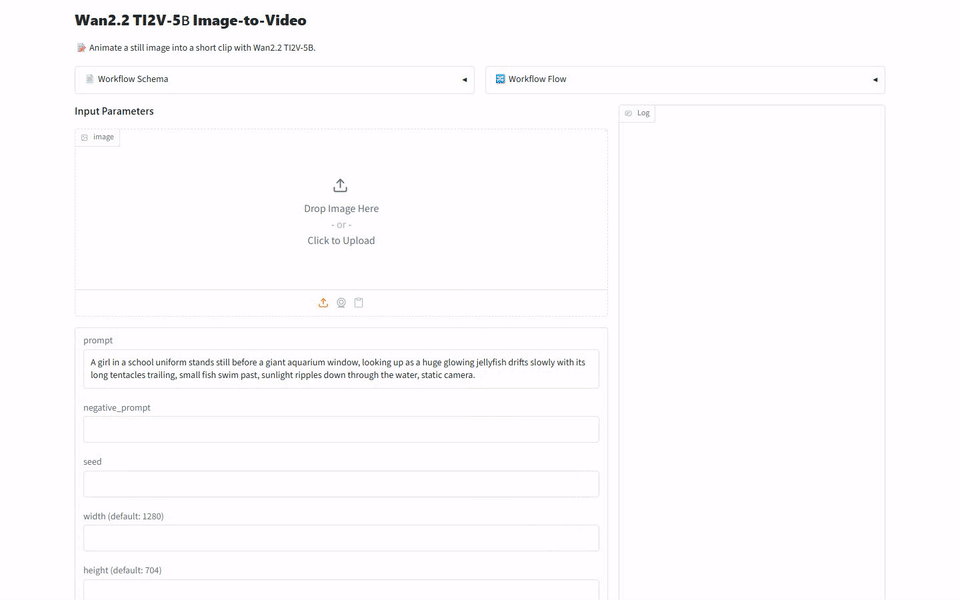
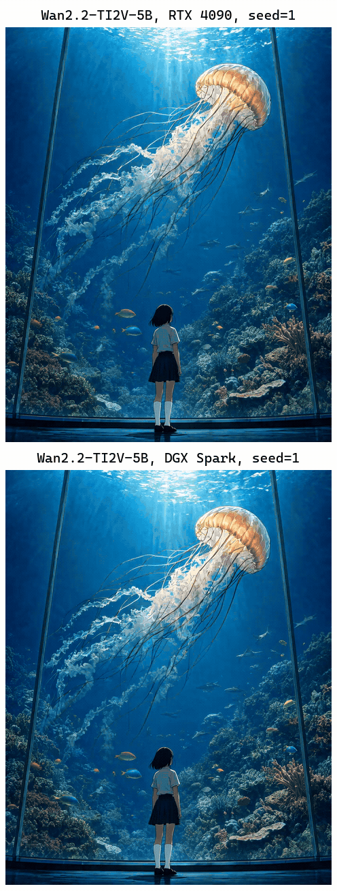
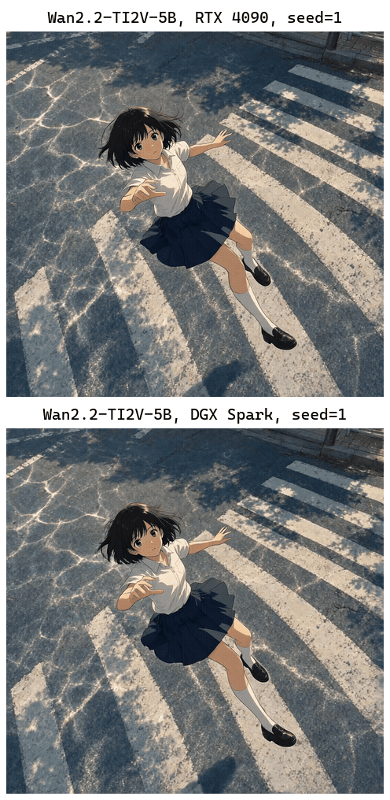
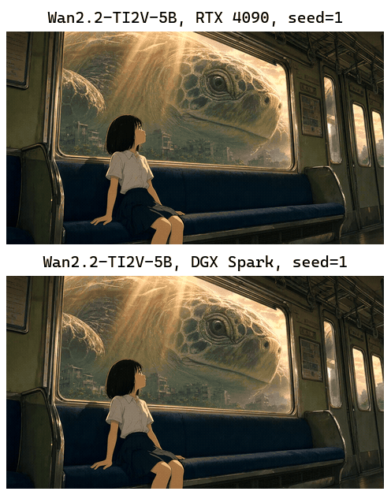

[English](README.md) · [한국어](README.ko.md) · [中文](README.zh.md)

# image-to-video-wan

这个服务接收一张图片和一段描述文字，用 Wan-AI/Wan2.2-TI2V-5B 生成一段短视频并返回。



## 快速开始

需要 [model-compose](https://github.com/hanyeol/model-compose) 0.4.120 或更高版本。

使用 [uv](https://docs.astral.sh/uv/) 安装：

```bash
uv pip install model-compose
```

或使用 pip 安装：

```bash
pip install model-compose
```

克隆此仓库：

```bash
git clone https://github.com/MindrLabs/image-to-video-wan
cd image-to-video-wan
```

运行：

```bash
model-compose up
```

API 地址为 http://localhost:8080/api ，Gradio 界面地址为 http://localhost:8081 。

## 摘要

RTX 4090 生成每段 5.04 秒视频的中位耗时为 526 秒，满足模型卡对单张消费级 GPU 的速度说法。

| 设备 | 状态 | RTF | 峰值内存 (MiB) |
| :---: | --- | --- | --- |
| DGX Spark | 已测量 | 281 | 30013 (VRAM) |
| RTX 4090 | 已测量 | 104 | 23942 (VRAM) |
| MacBook M1 16GB | 未测量 | — | — |

## 测量环境

使用 model-compose 0.4.120 测量。统计使用 95% 置信区间，低于 1.05× 的速度差异不作判定。

| 输入 | 权重 | 声明判定规则 |
| :---: | --- | --- |
| 3 个输入 × 1 次重复 | [Wan-AI/Wan2.2-TI2V-5B](https://huggingface.co/Wan-AI/Wan2.2-TI2V-5B/tree/921dbaf3f1674a56f47e83fb80a34bac8a8f203e) | fps = 24; pixels = 720p; aspect_ratio_error ≤ 0.05 |

## 结果

### 图生视频

以一张图片作为视频的开头，并同时输入描述动作的文字来生成视频。

| 声明 | 核对方式 | 设备 | 通过 |
| :---: | --- | --- | --- |
| TI2V-5B 生成 24fps 视频。 | 规则判定 | DGX Spark | ✓ |
| TI2V-5B 生成 24fps 视频。 | 规则判定 | RTX 4090 | ✓ |
| TI2V-5B 生成 720P 视频。 | 规则判定 | DGX Spark | ✓ |
| TI2V-5B 生成 720P 视频。 | 规则判定 | RTX 4090 | ✓ |
| TI2V-5B 视频保持输入图片的宽高比。 | 规则判定 | DGX Spark | ✓ |
| TI2V-5B 视频保持输入图片的宽高比。 | 规则判定 | RTX 4090 | ✓ |
| TI2V-5B 将图片变成跟随该图片的视频。 | 人工判定 | — | ✓ |
| TI2V-5B 在单张消费级 GPU 上用不到 9 分钟生成 5 秒的 720P 视频。 | 人工判定 | — | ✓ |

在 DGX Spark、RTX 4090 上进行了测量。未能在 MacBook M1 16GB 上进行测量。RTF 是处理耗时除以音频或视频时长，越低越快。每格为所测调用的中位数，计算时不计入在其他 GPU 任务期间进行的调用。

| 设备 | RTF | 每次调用秒数 | 峰值内存 (MiB) | aspect_ratio_error | duration_sec | fps | height | pixels | width |
| :---: | --- | --- | --- | --- | --- | --- | --- | --- | --- |
| DGX Spark | 281 | 1419 | 30013 (VRAM) | 0.0256 | 5.04 | 24 | 896 | 882688 | 1013 |
| RTX 4090 | 104 | 526 | 23942 (VRAM) | 0.0256 | 5.04 | 24 | 896 | 882688 | 1013 |



> A girl in a school uniform stands still before a giant aquarium window, looking up as a huge glowing jellyfish drifts slowly with its long tentacles trailing, small fish swim past, sunlight ripples down through the water, static camera.



> A girl in a school uniform drifts down through the air toward a sunlit crosswalk, her short hair and pleated skirt flutter in the wind, she reaches out with both arms, rippling light shimmers across the asphalt below and her shadow grows on the road, the camera slowly arcs a little around her, shifting the viewing angle.



> A girl sits on a train bench gazing out the window as a giant turtle glides past over a ruined, overgrown city, its eye blinking slowly, warm sunbeams shift across the carriage as the train sways gently, static camera.

## 建议

- RTX 4090 最多使用了 23942 MiB 的 GPU 内存，建议运行前先空出这么多内存。

## 局限与未测量的内容

- 3 个输入各只生成了一次，因此人工对动作的判断只适用于这些输出。

### 测量条件

| 项目 | 内容 |
| :---: | --- |
| 限制 | 测量时在服务器环境中设置了 PYTORCH_CUDA_ALLOC_CONF=expandable_segments:True，因为没有该设置时 RTX 4090 在 VAE 解码阶段内存不足。 |
| 限制 | 测量时使用 WAN_CPU_OFFLOAD=true，而 model-compose.yml 的默认值是 false。 |
| 声明判定规则 | 带规则的声明已在每台设备上与来源给出的数字对照判定。 |

### 未能测量的内容

| 对象 | 项目 | 原因 |
| :---: | --- | --- |
| MacBook M1 16GB | 全部测量 | 模型的 flash-attn 依赖无法在 Apple Silicon 上安装。 |
| DGX Spark 与 RTX 4090 | RTF | 在没有其他 GPU 任务的情况下，两台设备都只测量了 3 个输入，至少需要 20 个。 |
| DGX Spark 与 RTX 4090 | aspect_ratio_error | 两台设备都只评分了 3 个输入，至少需要 20 个。 |

### 未核实的模型卡声明

- 单 GPU 的 TI2V-5B 命令可在 RTX 4090 这样具有 24GB VRAM 的 GPU 上运行。

## 许可证

| 适用对象 | 许可证 | 商业使用 |
| :---: | --- | --- |
| 本服务 | [`LICENSE`](LICENSE) | ✓ |
| Wan2.2-TI2V-5B 权重 | [`MODEL_LICENSE`](https://huggingface.co/Wan-AI/Wan2.2-TI2V-5B/blob/main/README.md) | ✓ |
